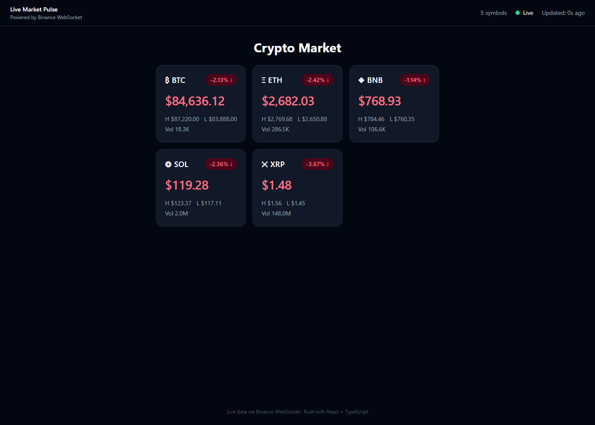
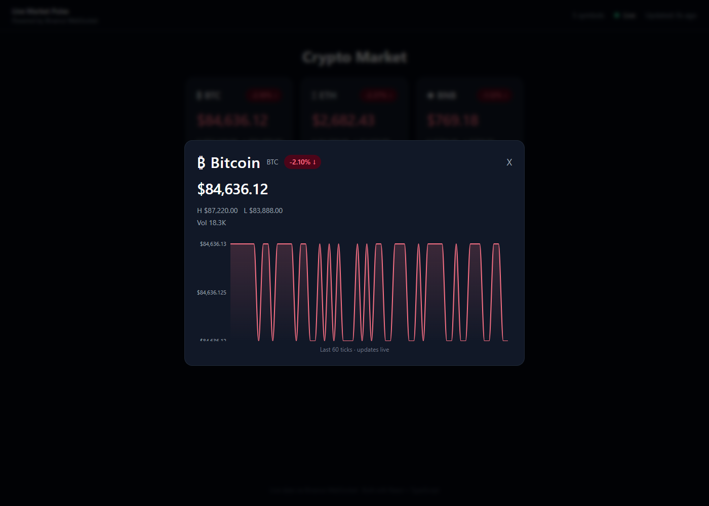

# Live Market Pulse

Real-time cryptocurrency dashboard powered by raw WebSockets — no polling, no libraries hiding the protocol.

## Live Demo

(deploy link will go here)

## Screenshot




## Features

- Live BTC, ETH, BNB, SOL, XRP prices with sub-second updates
- Click any card to open a rolling 60-tick price chart
- Flash animation on every price change (emerald ↑ / rose ↓)
- Auto-reconnect with exponential backoff + jitter if the connection drops
- Loading skeletons while the first snapshot loads
- Disconnected banner with retry counter
- Server acts as a relay — clients never connect directly to Binance

## Tech Stack

| Layer | Technology |
|---|---|
| Frontend | React 19, TypeScript, Vite, Tailwind CSS v3 |
| Charts | Recharts |
| Backend | Node.js, TypeScript, ws (raw WebSocket) |
| Linting | Oxlint |
| Formatting | Oxfmt |
| Data source | Binance public WebSocket stream (no API key required) |

## Architecture

The Node server is the only process that opens a socket to Binance. Browsers connect to the local relay, and the server broadcasts each tick to every connected client. One upstream connection keeps Binance rate limits under control no matter how many dashboards are open, and it leaves a single place to add authentication or another exchange later without changing the client.

The protocol is three JSON messages. On connect, the server sends a `snapshot` of the latest normalized ticker for every symbol in its cache. After that, each Binance update is forwarded as a `ticker` delta for that symbol. Every 25 seconds the server sends a `ping`; a client that does not pong within 10 seconds is terminated so dead sockets do not pile up.

If the Binance socket or a client socket drops, the next attempt waits `min(30s, 1000 × 2^attempt)` plus up to one second of random jitter. The delay doubles on each failure and resets after a successful open. Jitter matters because a shared outage would otherwise reconnect every client at the same instant — a thundering herd against Binance and the relay.

On the frontend, `useMarketSocket` owns the WebSocket lifecycle: it applies the snapshot, merges ticker deltas into `tickers` state, and tracks connection status plus the retry count. `App` renders that state as `TickerCard`s. `usePriceHistory` appends each new price to a rolling 60-tick buffer and flushes it to React about once a second, and the selected series is what `PriceChart` draws inside the chart modal.

## Project Structure

```
live-market-pulse/
├── server/
│   └── src/
│       ├── index.ts        # WS relay server — Binance connection, client broadcast, heartbeat
│       └── types.ts        # Shared TypeScript types
├── client/
│   └── src/
│       ├── hooks/
│       │   ├── useMarketSocket.ts   # WS lifecycle, reconnect, state
│       │   └── usePriceHistory.ts  # Rolling price buffer, throttled flush
│       ├── components/
│       │   ├── TickerCard.tsx
│       │   ├── TickerCardSkeleton.tsx
│       │   ├── StatusBar.tsx
│       │   ├── DisconnectedBanner.tsx
│       │   ├── PriceChart.tsx
│       │   └── ChartModal.tsx
│       ├── utils/
│       │   └── coinMeta.ts
│       ├── types.ts
│       └── App.tsx
└── README.md
```

## Getting Started

### Prerequisites

- Node.js 18+

### Run locally

```bash
# 1. Clone
git clone https://github.com/HamedTaherpour/live-market-pulse.git
cd live-market-pulse

# 2. Install server deps
cd server && npm install

# 3. Install client deps
cd ../client && npm install

# 4. Start the server (port 8080)
cd ../server && npm run dev

# 5. In a new terminal, start the client
cd client && npm run dev
```

Open http://localhost:5173

## WebSocket Message Protocol

```ts
// Sent once on connect — initial state
{ type: "snapshot", data: NormalizedTicker[] }

// Sent on every Binance tick
{ type: "ticker", data: NormalizedTicker }

// Heartbeat every 25s — client must pong or gets terminated
{ type: "ping" }
```

## License

MIT
